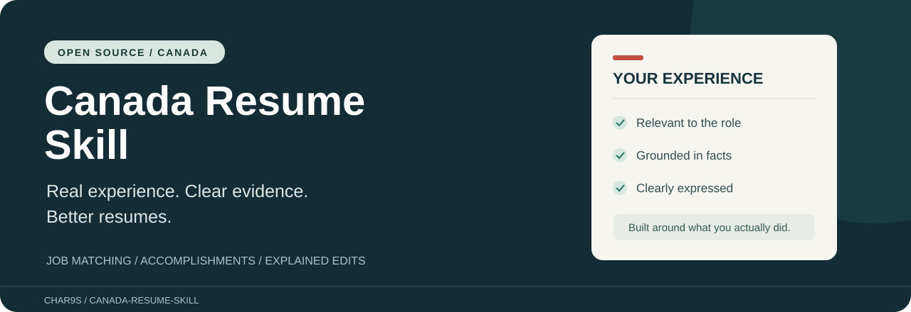
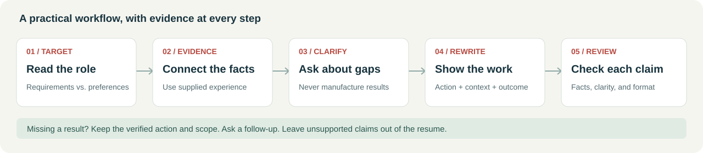

<p align="center"></p>

# Canada Resume Skill

**Career Evidence · 01 / Resume** · By [CHAR9S](https://github.com/CHAR9S)

**Make your experience easier for Canadian employers to understand.** An open-source AI skill informed by Canadian employment-service training materials and public employment guidance. Match your experience to a specific role, turn duties into grounded accomplishment statements, and understand every edit.

[中文说明](README.zh-CN.md) · [Quick start](#quick-start) · [Worked example](examples/administrative-assistant.md) · [Discussions](https://github.com/CHAR9S/canada-resume-skill/discussions) · [Source notes](skills/canada-resume/references/sources.md)

[](LICENSE)
[](CHANGELOG.md)
[](https://agentskills.io/specification)

## See the difference

| Before | Evidence supplied | After |
| --- | --- | --- |
| “Helped with inventory.” | Checked packing slips, logged discrepancies in Excel, flagged mismatches | “Checked deliveries against packing slips, recorded discrepancies in Excel, and flagged mismatches to the supervisor.” |
| “Helped new staff.” | Demonstrated the closing checklist to three colleagues; no supervisory role | “Trained three new colleagues on the closing checklist during the summer.” |

These are fictional examples. The skill must not invent a percentage improvement, promote training to management, or copy example numbers into your resume.

## What you get

- A focused diagnosis of the changes that matter most.
- A job-requirement map showing supported claims, questions, and evidence gaps.
- A clean revised draft using your real experience.
- Clear reasons for edits and a short list of facts to confirm.
- Canadian application conventions, with room for role-specific exceptions.

Useful for newcomers, students, career changers, and experienced applicants. International work, projects, and volunteering count when relevant; they retain their real labels.

This is an instruction package for an AI assistant, not a hosted resume builder. It has no account system, runtime dependencies, tracking code, or paid scoring API. Your chosen AI provider still processes the information you share under its own terms.

## Quick start

### Option 1: try it in an AI chat

Download this repository using **Code → Download ZIP** and extract it. Give your assistant `skills/canada-resume/SKILL.md` and the four Markdown files in its `references` folder, then provide your resume and target posting. If file attachments are unavailable, paste those files' text.

```text
Use the attached Canada Resume skill to tailor my resume to this job posting.
Start with the strongest evidence and the most important gaps.
Ask before adding a result or skill that my material does not support.
Give me the revised resume and explain the changes.
```

This is manual use of the instructions, not automatic skill installation. File support and results depend on your assistant. Start with a redacted resume if you prefer.

### Option 2: install in a Codex project

Copy the entire `skills/canada-resume` folder into your working project's `.agents/skills/` directory. The result should be `.agents/skills/canada-resume/SKILL.md`, with `references/` and `agents/` beside it. Do not overwrite an existing installation without reviewing it.

Start a new session if the skill is not discovered, then ask:

```text
Use $canada-resume to tailor my resume to this Canadian job posting.
Explain the edits in Chinese and write the resume in English.
```

Installation guidance follows [OpenAI's skill documentation](https://learn.chatgpt.com/docs/build-skills). For other Agent Skills clients, copy the same complete skill folder to the location documented by that client. Cross-client execution has not been independently tested in this release.

## How it works



The skill first distinguishes requirements from preferences. It then links each important requirement to your supplied experience. Missing evidence leads to a question or an explicit gap, not a fabricated qualification.

| Ask for | Example request |
| --- | --- |
| A quick audit | “Review my Canadian resume and give me the five highest-impact fixes.” |
| A tailored draft | “Match my experience to this posting, then rewrite my resume.” |
| Better bullets | “Improve these three bullets without adding facts.” |
| A first resume | “Help me build a resume from my coursework and volunteer experience.” |
| A career transition | “Show how my retail experience relates to this office support role.” |
| Role exploration | “Compare these four postings and identify recurring requirements.” |

## Principles and limits

**Facts before polish.** No invented metrics, Canadian experience, credentials, language proficiency, or work authorization. No keyword stuffing or unexplained ATS scores.

**Conventions with context.** One-to-two-page resumes and clear sections are starting points. A government's screening instructions, an academic CV, or a specialized application may require something different.

**Honest output status.** A text draft has not had its pagination or ATS parsing verified. Document export requires an assistant with the relevant file tools and an actual layout check. This skill does not guarantee interviews or job offers.

**Private by default in the workflow.** The skill does not submit applications or upload resumes to external scoring services. Do not post real resumes, contact details, or employer-confidential material in public issues or discussions.

## Project map

```text
skills/canada-resume/
  SKILL.md                    Core workflow
  agents/openai.yaml          Codex display metadata
  references/                Conventions, evidence, review, sources
examples/                    Fictional end-to-end worked example
docs/assets/                 Original banner and workflow diagram
docs/                        Evaluation cases and release notes
scripts/validate.py          Local package and link checks
.github/                     Issue, discussion, and PR templates
```

## Quality and evidence

The workflow draws on resume-training handouts from a Canadian employment-service organization and was cross-checked against public Canadian employment guidance. It uses original instructions and examples; the source scan is not included. See [source notes and editorial changes](skills/canada-resume/references/sources.md).

Release 0.1.0 is an initial public version. [Evaluation cases](docs/evaluation.md) document what to test, and [validation status](docs/validation.md) distinguishes completed checks from untested behavior. There is no measured claim of better hiring outcomes.

To check the package locally with Python 3.10+:

```sh
python scripts/validate.py
```

## Help make it useful

Try one task and tell us what happened in [Discussions](https://github.com/CHAR9S/canada-resume-skill/discussions). A useful report includes the role, your AI client, what improved, and what still needed fixing—using fictional or fully redacted text.

Found a rule that needs correction? [Open an issue](https://github.com/CHAR9S/canada-resume-skill/issues/new/choose) with the source and context. Read [CONTRIBUTING.md](CONTRIBUTING.md) before submitting a change. If the skill helps you, a star makes it easier for others to find; follow [CHAR9S](https://github.com/CHAR9S) for future work.

## About the creator

CHAR9S is an independent designer and builder with 15+ years in motion and visual design, spanning film titles, CG content, brand identity, and creative studio practice. Experience taking projects from brief to delivery informs an approach to AI built around clear inputs, deliberate choices, and review.

Current work includes generative imagery and video workflows, design, and web projects. On GitHub, that practice extends into reusable AI skills: documented ways to organize information, produce a useful draft, and check the result. Career Evidence applies this approach to resumes and interview presentations, drawing its career-specific guidance from employment resources.

## Licence and attribution

[MIT](LICENSE) for original project files. Third-party source materials retain their own rights. This project is independent and is not endorsed by the training-material provider, government employment services, or any AI vendor.
