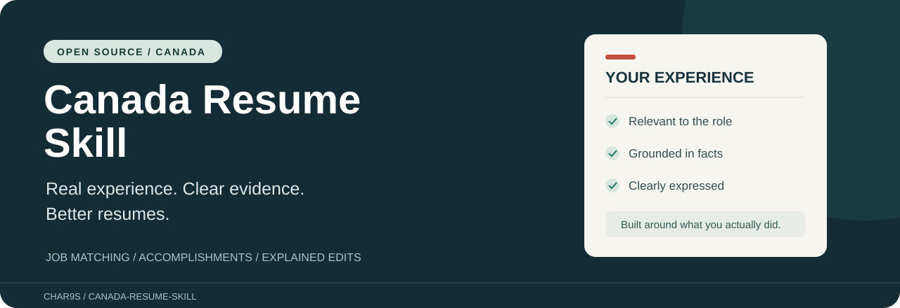
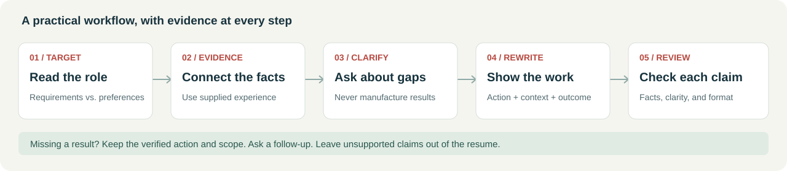

# Canada Resume Skill · 加拿大求职简历优化技能

**Career Evidence 系列 · 01 / 简历** · 作者：[CHAR9S](https://github.com/CHAR9S)

**让真实经历，更符合加拿大招聘语境。** 提炼加拿大本地就业服务机构的简历培训资料，结合公开就业指导，将岗位分析、经历核对与成果表达整理成可直接使用的 AI 工作流。

围绕具体岗位调整，贴近本地申请习惯；把职责写成有依据的贡献，每次修改都有理由。

[English](README.md) · [完整示例](examples/administrative-assistant.md) · [讨论区](https://github.com/CHAR9S/canada-resume-skill/discussions) · [资料来源](skills/canada-resume/references/sources.md)

## 它能帮你做什么

- 诊断简历，优先处理最影响岗位匹配的问题。
- 对照招聘要求，列出已有证据、待确认内容和未体现的能力。
- 把职责描述改成具体的行动和成果，保留真实贡献范围。
- 帮助新移民、学生、转行者整理国际经历、项目和志愿服务。
- 用中文解释修改，按申请需要输出英文或其他指定语言的简历。

例如，“帮忙处理库存”可以在用户确认工作内容后，改成“核对送货单，在 Excel 记录差异，并向主管报告不符项”。没有数据就不添加“降低错误率 35%”。

## 马上试用

### 不安装，也能用

点击仓库的 **Code → Download ZIP**，解压后，将 `skills/canada-resume/SKILL.md` 和 `references` 文件夹里的四份 Markdown 文件一起交给支持附件的 AI。也可粘贴文件内容，再提供自己的简历和目标岗位描述。

```text
请按附件中的 Canada Resume 技能优化我的简历。
对照这个加拿大职位，先分析岗位要求和我的真实证据。
不要编造数字、技能、证书或加拿大工作经历。
需要补充信息时先问我；用中文解释修改，简历用英文。
```

这是手动使用技能说明，效果和附件支持取决于你的 AI 工具。建议先用脱敏材料试用。

### 在 Codex 项目里安装

把完整的 `skills/canada-resume` 文件夹复制到工作项目的 `.agents/skills/` 下，确保文件路径为 `.agents/skills/canada-resume/SKILL.md`，并保留参考文件和元数据。已有同名技能时，先比较再更新。

若没有自动发现技能，新开一个会话，输入：

```text
用 $canada-resume 对照这个加拿大岗位优化我的简历。
```

其他支持 Agent Skills 的客户端，请按其文档放置完整技能目录。第一版尚未完成独立的跨客户端实测。[官方安装说明](https://learn.chatgpt.com/docs/build-skills)。

## 工作流程



完整优化通常包含：关键诊断、岗位与经历对应表、简历正文、修改说明、待确认事项。只改一句经历时，不会强制输出整套报告。

## 使用边界

这是一套开源 AI 指令，不是独立网站。无需本项目的账号或付费接口，但你使用的 AI 服务可能收费，并按自己的政策处理输入信息。

技能不保证通过 ATS、获得面试或录用。只输出文字时，不声称已验证分页和文件解析。政府招聘、学术 CV、受监管职业应按具体申请要求处理。技能不会替你投递或联系雇主。

不要在公开 Issue 或讨论区上传真实简历、联系方式或雇主机密。示例均为虚构；原始教学扫描件没有随仓库公开。

## 一起改进

欢迎在[讨论区](https://github.com/CHAR9S/canada-resume-skill/discussions)分享具体使用体验：目标岗位、AI 工具、哪些修改有用、哪些地方仍需要人工修正。发现问题可[提交 Issue](https://github.com/CHAR9S/canada-resume-skill/issues/new/choose)。

第一版的[验证状态](docs/validation.md)和[评估场景](docs/evaluation.md)公开可查。如果这个技能对你有帮助，欢迎 Star，也可关注作者 [CHAR9S](https://github.com/CHAR9S)。

原创项目内容使用 [MIT 许可证](LICENSE)。第三方资料保留原有权利，本项目不代表资料提供机构或 AI 平台。

## 关于作者

我是 CHAR9S，独立设计师与创作者，拥有 15 年以上动态与视觉设计经验，做过电影片头、CG 内容和品牌视觉，也经营过创意工作室。我的工作一直贯穿从最初想法到最终交付的过程。

这段制作经历也影响了我使用 AI 的方式：先弄清任务，整理素材，做出有依据的创作选择，再检查结果。目前的实践涵盖生成式图像与视频流程，以及设计和网站项目。

在 GitHub 上，我探索的是这段经验的另一种用法：把具体任务中的有效方法整理成可复用的 AI Skills，明确输入、步骤、事实依据和检查方式。设计与这些项目之间的联系，是让复杂的信息更容易理解，让工作方法更容易被使用。

Career Evidence 将这套方法用于简历与面试展示，求职建议参考就业培训资料。作者的专业背景是设计与制作，不宣称招聘或职业咨询资质。
